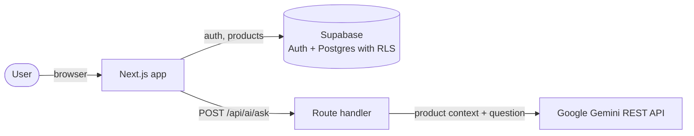

# Loan Picks Dashboard: High-Level Design

A personalized loan-discovery dashboard: sign in, browse loan products with smart filters and badges, open product details and ask an AI assistant questions about a specific loan. Live at [v0-loan-product-dashboard-pi.vercel.app](https://v0-loan-product-dashboard-pi.vercel.app). For code-level detail see the [Low-Level Design](lld.md).

## 1. Context

## 2. Components

| Component | Responsibility |
|---|---|
| Middleware (`middleware.ts`, `lib/supabase/proxy.ts`) | Refreshes the Supabase session; sends signed-out users to `/auth/login` and signed-in users away from auth pages |
| Auth pages | Login, sign-up, verify-email, email confirmation callback |
| Dashboard (`/`) | Top picks with badges |
| Products page (`/products`) | Full catalog with filters |
| Chat drawer | Per-product AI assistant |
| `GET /api/products` | Filtered product search |
| `POST /api/ai/ask` | Builds a product-grounded prompt and calls Gemini |

## 3. Tech

| Layer | Choice |
|---|---|
| Framework | Next.js (App Router) + TypeScript |
| UI | Tailwind CSS, shadcn/ui (Radix), theme provider |
| Data / auth | Supabase (`@supabase/ssr`), Postgres with row-level security |
| AI | Gemini via REST (`GOOGLE_GENERATIVE_AI_API_KEY`), preferring `gemini-2.5-flash` |
| Validation | zod |
| Hosting | Vercel |
