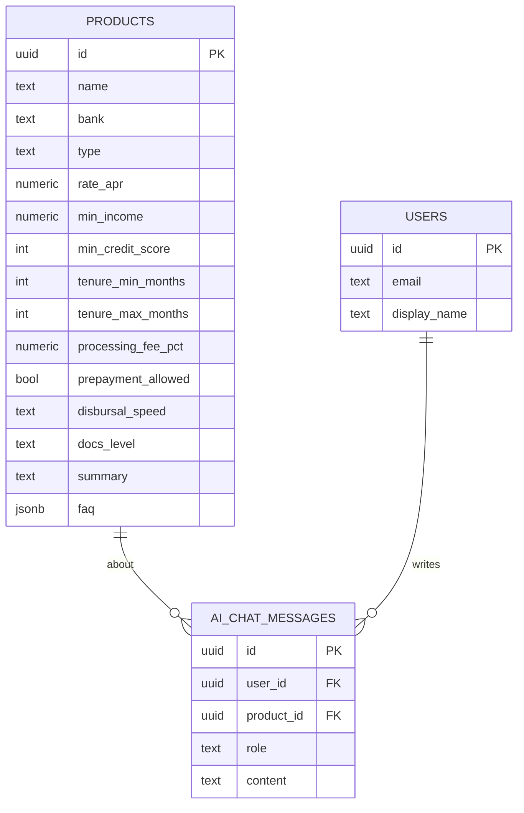
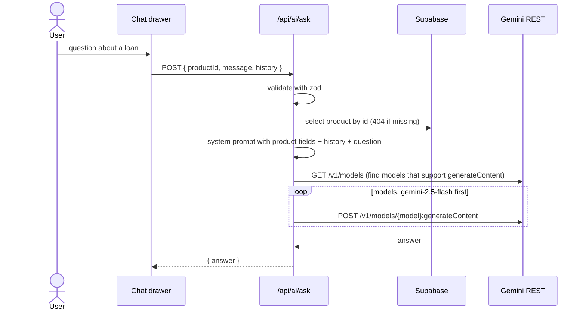

# Loan Picks Dashboard: Low-Level Design

For the big picture see the [High-Level Design](hld.md).

## 1. Database (`scripts/001_create_schema.sql`)

Row-level security: anyone can read products; users can only read or write their own user row and chat messages. Product types: personal, education, vehicle, home, credit line, debt consolidation. Seed data is in `scripts/002_seed_products.sql`.

## 2. `GET /api/products`

| Query param | Filter |
|---|---|
| `bank` | `ilike %bank%` |
| `minApr`, `maxApr` | `rate_apr` range |
| `minIncome` | products with `min_income ≤` value (you qualify) |
| `minCreditScore` | products with `min_credit_score ≤` value |
| `type` | exact type |
| `limit` | 1–100 |

Results are sorted by APR, lowest first. Params are validated with zod.

## 3. Badges (`getBadges`)

| Badge | Rule |
|---|---|
| Low APR | `rate_apr ≤ 7` |
| No Prepayment Penalty | `prepayment_allowed` |
| Fast Disbursal | `disbursal_speed = fast` |
| Flexible Tenure | max − min tenure ≥ 50 months |
| Low Docs | `docs_level = minimal` |
| Zero Processing Fee | `processing_fee_pct = 0` |
| Salary > ₹nL Eligible | `min_income ≤ 4,00,000` |

## 4. Ask the AI

The route tries each available model in turn until one succeeds, so the assistant keeps working if a model is retired.
